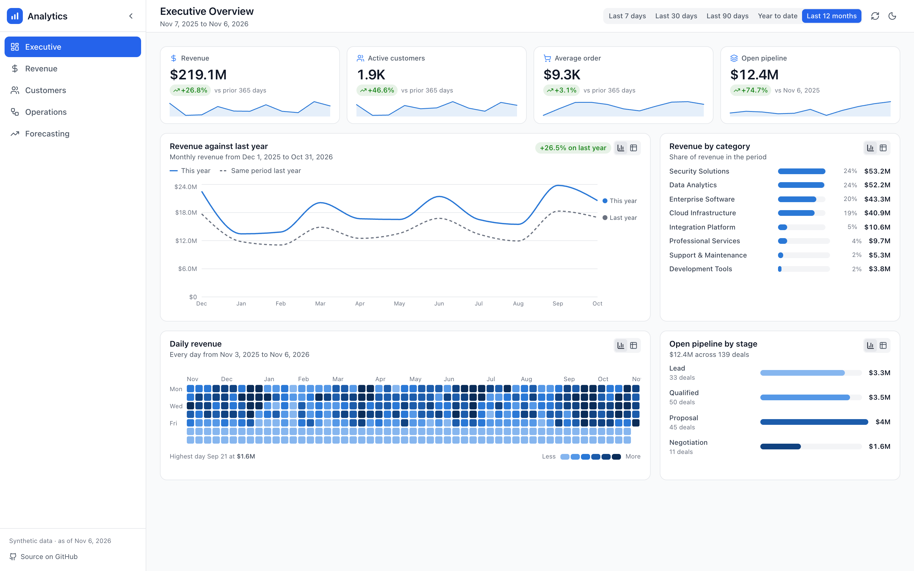
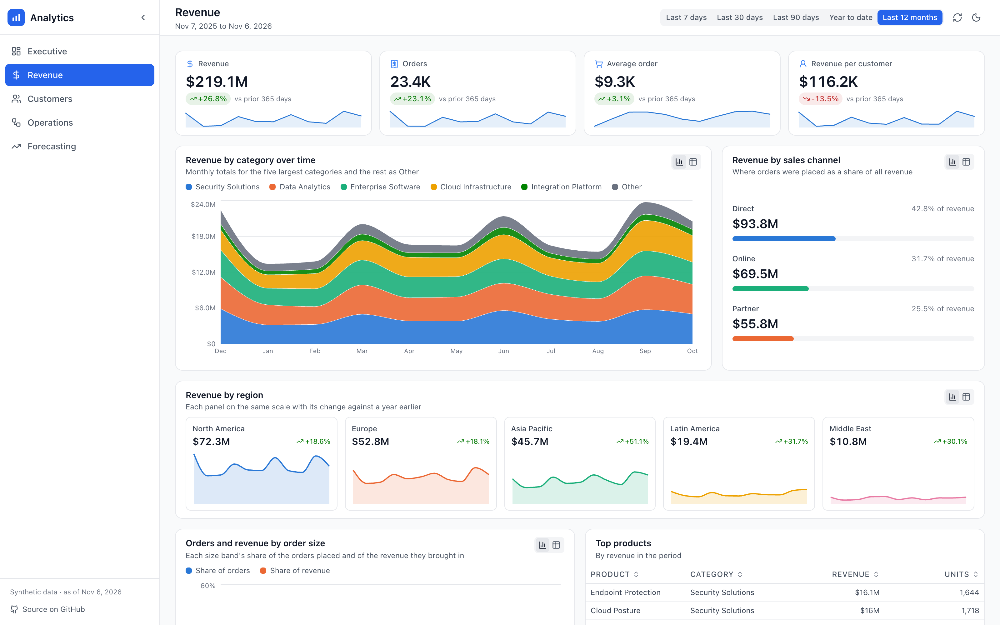
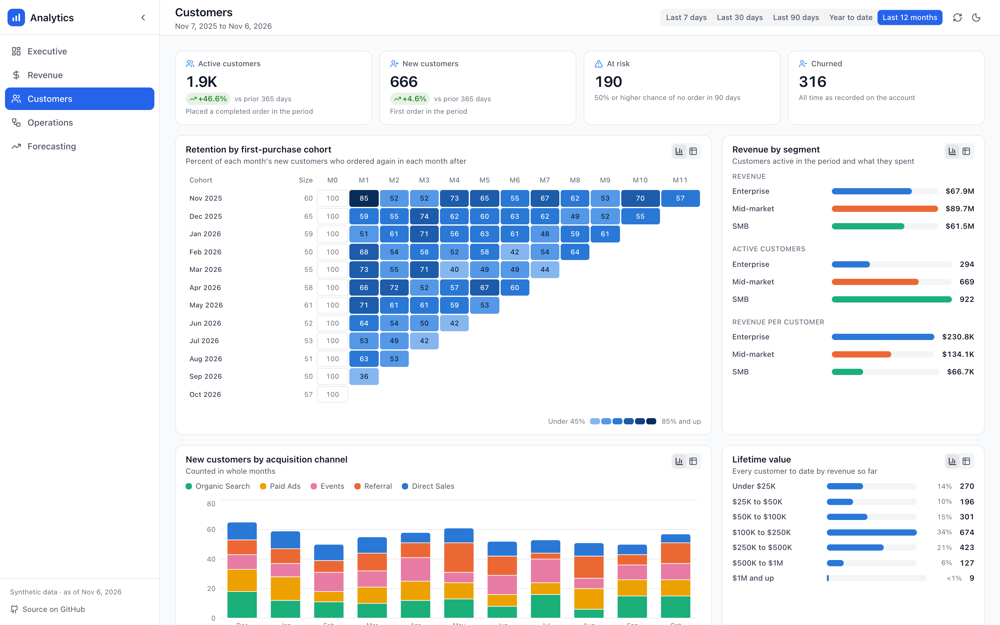
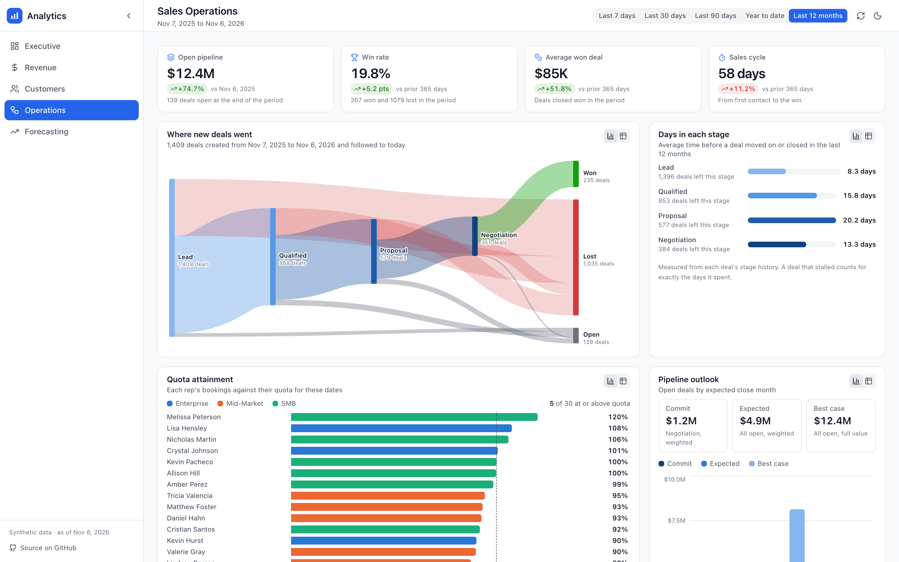
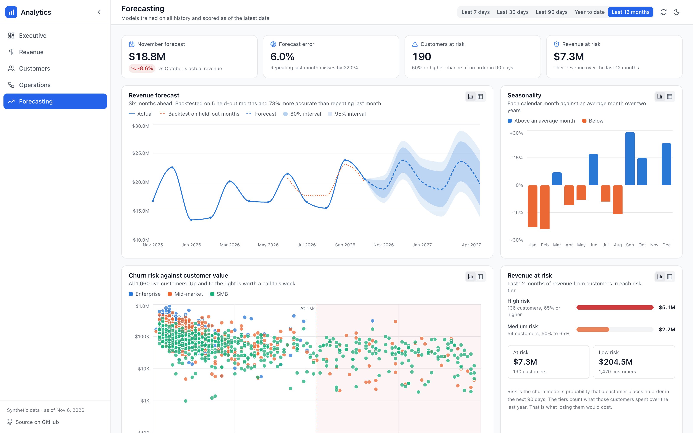

# Analytics Dashboard

A business intelligence platform for a B2B software company with five pages of reporting over one warehouse. It covers revenue, customers, the sales pipeline, and forecasting. Built with React 19, Flask, PostgreSQL, and scikit-learn.

### **[Open the live demo](https://www.ryansansbury.com/analytics-dashboard/)**

No signup. Everything on screen came out of the code in this repository. The queries ran against PostgreSQL and the churn and forecasting numbers come from scikit-learn models scored on data they never trained on.

[](https://github.com/ryansansbury/analytics_dashboard/actions/workflows/ci.yml)


<picture>
  <source media="(prefers-color-scheme: dark)" srcset="docs/screenshots/executive-dark.png">
  
</picture>

## The five pages

**Executive.** Four headline figures with their trend and their change on the prior period of equal length. Revenue sits against the same weeks or months a year earlier. A quarter-end spike lines up with last year's, and the gap between the lines is growth. A calendar of every day's revenue for a year shows the quiet weekends, the quarter-end pushes, and the year's growth at a glance.

**Revenue.** The category mix as a stacked area over time, sales channels as ranked bars, and each region as a small multiple on a shared scale with its change on a year earlier. Order sizes compare each band's share of orders with its share of revenue.



**Customers.** Retention by first-purchase cohort as a heatmap, revenue and customers by segment, new customers by acquisition channel, the lifetime value distribution, and the live accounts the churn model ranks as most likely to stop buying.



**Operations.** A Sankey diagram follows a year of new deals through every stage to won, lost, or still open. Beside it are the days spent in each stage, every rep's attainment against a quota prorated to the dates on screen, and the open pipeline by expected close month.



**Forecasting.** Six months ahead with 80% and 95% intervals and a backtest drawn over the months the model never saw. Seasonality by calendar month, every live customer plotted by churn risk against what they spent last year, and the checks behind both models.



Every chart has a table view with a CSV download, and the whole interface works on a phone.

## The models

Two of them. Each is measured on data it never trained on.

| Model | Task | Validation | Result |
|---|---|---|---|
| `GradientBoostingClassifier` | Will a live customer go 90 days without an order | Features frozen at a cutoff 90 days back and labeled by what happened after it, then a stratified holdout | **0.78 ROC AUC** against a base rate of 19% |
| `Ridge` on engineered time features | Monthly revenue six months ahead | Chronological holdout of the last five months | **6.0% MAPE** against 22.0% for repeating last month |

The churn model answers a question someone could act on. Every feature is computed from the transactions on or before a cutoff date, and the label is whether the customer bought anything in the 90 days after it. Nothing from after the cutoff can reach a feature, and a test enforces that.

An earlier version trained on the customer's status column instead. That taught it to recognize customers who had already left. Recency alone does that almost perfectly. It scored 0.96 ROC AUC and then rated nearly every live customer under 10% because none of them looked like the customers who were gone. A lower number from a model asking the right question is the better model.

The forecast is validated chronologically and never on a shuffled split. Shuffling lets a time-series model train on the future to predict the past. Its features are a trend, a yearly cycle, a flag for the quarter-end months, and two lags. The quarter-end flag earns its place because deals pulled into March, June, September, and December are a real B2B pattern that a smooth yearly curve can't draw. MAPE on its own says little. The API reports it beside the error of two naive baselines and the page draws the backtest over the actuals.

`/api/forecasting/model-performance` returns the exact numbers above, and `backend/tests/test_forecasting_api.py` asserts the endpoint matches the trained model rather than deriving anything.

## How the charts are built

Each chart's form follows the question it answers. Ranked bars replaced every pie and donut because lengths along a shared baseline can be compared and angles can't. Regions are small multiples on one scale instead of five tangled lines, and cohort retention is a triangle of shaded cells where months a cohort hasn't reached are empty rather than zero.

Color follows the entity and never its rank. A category keeps its color when a filter reorders the categories, and anything past eight series folds into Other in a muted gray. The categorical palette and the sequential heatmap ramp were each checked with a validator for separation under color vision deficiency, lightness steps, and contrast against both the light and the dark surface. Text and values wear text colors and a pale series color never carries a number.

Charts draw without animation when the visitor's system asks for reduced motion.

## Two rules this codebase holds to

**Numbers are measured and never generated.** This application used to report model accuracy and churn scores from `random.uniform()`. All of it comes from trained models now. Where a figure can't be derived the API returns `null` and the page renders a dash. A null change means there is no prior period to compare against and not that the change was zero.

**A partly covered time bucket is not plotted.** Nine days of a month beside twelve finished ones reads as a collapse rather than as a month that isn't over, and a window that opens on a Thursday would start with a three-day week that reads as a dip. The newer endpoints trim both ends of a window to whole buckets with the rule in `backend/app/analytics.py`. The original trend endpoint trims its unfinished last bucket with the rule in `backend/app/periods.py`.

## The hosted demo is a static build

The application runs against live PostgreSQL. That is the real mode and every instruction below describes it.

The demo is a build artifact of that same application with no server and no database. `backend/scripts/snapshot.py` boots the real Flask app, trains the models, walks every request the interface makes under all five date presets, and freezes the responses to `frontend/public/data/`. The React build reads those files and one flag switches it.

```bash
npm run build          # live, talks to Flask and Postgres
npm run build:static   # static, reads the snapshot
```

The demo lives at `/analytics-dashboard/` on the website beside the site's other demos. A static build is based at that folder, the refresh script stages it into the website, and the website's own deploy publishes it.

```bash
./scripts/refresh-demo.sh               # reseed, snapshot, test, build, stage into the site
./scripts/refresh-demo.sh --no-stage    # everything except staging
./scripts/refresh-demo.sh --check-live  # after the site's deploy, check the live demo
```

The coverage test runs before anything is staged. A snapshot missing an endpoint stops the release instead of reaching production as a blank chart. The script pins its own database rather than reading an ambient `DATABASE_URL` because inheriting one points a reseed at whatever project exported it.

Every number in the demo came out of the real pipeline. The demo's clock is frozen at the date the snapshot was taken and the sidebar says so, and the presets resolve against that date so they never ask for a window the snapshot doesn't hold.

`scripts/screenshots.py` opens the built demo in headless Chrome and takes the README's pictures and a review set of every page in both themes at desktop, tablet, and phone widths. It fails on a console error, a failed request, a page wider than its window, or a card that drew nothing.

## Testing

```bash
./scripts/check.sh     # everything CI runs, against a local test database
```

That runs 187 backend tests and 218 frontend tests plus lint and a type-checked build. CI runs the same on every push with a gitleaks scan, and the backend job starts its own PostgreSQL service so the cross-endpoint consistency suite runs there instead of skipping.

The frontend suite includes a coverage check that mounts every page under every preset and serves `fetch` from the snapshot directory. A request the snapshot doesn't cover fails a test rather than producing a blank chart.

Destructive fixtures refuse to run against a database whose name doesn't end in `_test`. Pointing them at a working database destroys the data in it while every test still passes.

## Stack

**Frontend.** React 19 and TypeScript on Vite with TailwindCSS 4, Recharts, TanStack Query, and React Router 7.

**Backend.** Flask 3 and SQLAlchemy over PostgreSQL 15 with pandas and scikit-learn. Gunicorn in production.

## Getting started

You need Python 3.11 or later, Node 22 or later, and PostgreSQL 15 or later.

```bash
git clone https://github.com/ryansansbury/analytics_dashboard.git
cd analytics_dashboard
./scripts/setup-local.sh
```

The setup script finds Python and PostgreSQL, creates the database, builds the backend's virtual environment, and installs the frontend's packages. It installs no system software and prints the Homebrew command for anything missing. Then seed the data and start the API.

```bash
cd backend
venv/bin/python reseed.py      # two years of data, about a minute
venv/bin/python run.py         # http://localhost:5001
```

Start the interface in a second terminal.

```bash
cd frontend
npm run dev                    # http://localhost:3000
```

Port 5001 rather than 5000 because AirPlay Receiver holds 5000 on macOS. The dev server proxies `/api` to Flask. Both halves share an origin and no CORS setup is needed.

Check it came up with `curl -s localhost:5001/api/health`. It reports row counts and the data's age. Every other endpoint returns 200 with empty results against an empty database. That is correct and looks exactly like a broken deployment.

Docker works too with `docker compose up` and then `docker compose exec backend python reseed.py` once Postgres is accepting connections.

### Production

```bash
cd frontend && npm run build
cp -r dist/* ../backend/static/
```

Flask then serves the API and the compiled interface from one origin with SPA fallback. `backend/static/` is gitignored because it is build output.

## API

35 endpoints across five blueprints. All are GET and all return JSON. The full reference with parameters and response shapes is in [`docs/API.md`](docs/API.md).

| Prefix | Covers |
|---|---|
| `/api/dashboard` | Headline figures with their trends against the prior period |
| `/api/revenue` | Comparison with a year earlier, category and region trends, the daily calendar, channels, order sizes, and products |
| `/api/customers` | Cohorts, segments, acquisition, lifetime value, churn risk against value, and at-risk accounts |
| `/api/operations` | Pipeline flow, win rate and cycle time from stage history, stage durations, and rep attainment |
| `/api/forecasting` | Revenue forecast with intervals and backtest, seasonality, revenue at risk, and model metrics |

There is no seeding endpoint. Seeding is destructive and lives at the command line.

## Structure

```
analytics_dashboard/
├── backend/
│   ├── app/
│   │   ├── ml/               # features, churn, revenue, lazy-training registry
│   │   ├── models/           # SQLAlchemy models, one per file
│   │   ├── routes/           # five blueprints, one per domain
│   │   ├── analytics.py      # the calculations behind the newer charts
│   │   ├── periods.py        # the time-bucketing rule
│   │   └── __init__.py       # application factory and /api/health
│   ├── data/seed_data.py     # synthetic data generator
│   ├── scripts/              # snapshot.py and inspect_seed.py
│   └── tests/
├── frontend/
│   ├── public/data/          # the generated snapshot
│   └── src/
│       ├── components/       # cards, charts, tables, layout
│       ├── hooks/            # one query hook per endpoint, plus filters
│       ├── pages/            # the five pages
│       └── services/         # api client and the static adapter
├── scripts/                  # setup, checks, screenshots, and the demo refresh
└── docs/                     # API, architecture, decisions, setup
```

## Data

Seven tables hold products, customers, sales reps, transactions, pipeline opportunities, their stage history, and daily metrics. There are about 2,000 customers, 45,000 orders, and 1,800 opportunities with about 5,800 stage changes across two years. `backend/data/seed_data.py` generates all of it.

The generator builds in the patterns a real business has so the charts have something true to show. Revenue grows about 27% a year with a December peak, a late-summer lull, and a push in the last ten days of every quarter. Weekends are quiet. Asia Pacific and the cloud and data categories grow faster than the rest, online orders gain share, and each rep's quota is set from their own trailing year so attainment spreads around target. Each opportunity walks through the stages with its own timing. That is what makes win rate and cycle time measurable.

Churn is driven by behavior instead of assigned at random. A latent engagement variable drives order frequency and the churn hazard together, and accounts at risk fade out over their last six months rather than stopping dead. `backend/scripts/inspect_seed.py` prints the dataset's shape without a database.

The generator is deterministic but anchors its window to today minus two years. A rerun reproduces the same dataset re-dated rather than a different one.

## Environment

| Variable | Default | Purpose |
|---|---|---|
| `DATABASE_URL` | local Postgres | Connection string |
| `FLASK_ENV` | `development` | Selects the config class |
| `SECRET_KEY` | dev placeholder | Set a real value in production |
| `TEST_DATABASE_URL` | `..._test` | Tests only. Must end in `_test` |
| `VITE_API_URL` | `/api` | API base. Unset uses the dev proxy |
| `VITE_STATIC_DATA` | unset | `true` builds the static demo |

## Docs

- [`docs/API.md`](docs/API.md) covers every endpoint with parameters and response shapes.
- [`docs/ARCHITECTURE.md`](docs/ARCHITECTURE.md) covers how the pieces fit.
- [`docs/DECISIONS.md`](docs/DECISIONS.md) records the choices and what each one cost, including the ones later reversed.
- [`docs/SETUP.md`](docs/SETUP.md) goes deeper on installing and running it.

## License

The code is under the [PolyForm Noncommercial License 1.0.0](LICENSE). You're welcome to read it, run it, and change it for personal, educational, research, or other noncommercial use, and commercial use isn't permitted.
